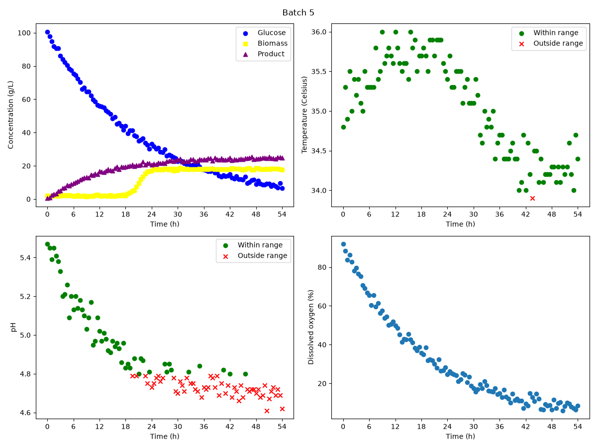

# FermWatch

A Python program that creates dashboards and summary tables from fermentation batch data.

## Overview

pH and temperature affect cell growth and product formation in a fermentation. The goal of this project was to
check if each batch stayed within its acceptable pH and temperature ranges, and to compare the batches.

Objectives:
- Extract each batch from the dataset.
- Find which measurements are within the acceptable ranges.
- Make a dashboard for each batch.
- Make a summary table that compares all batches.

## Features

The `BioprocessMonitor` class can:
- Read the dataset and store the pH and temperature limits.
- Count the number of batches (`get_n_batches`).
- Extract one batch (`extract_batch`).
- Check if pH and temperature are within range (`optimal_ph_mask`, `optimal_temperature_mask`).
- Save a 2 × 2 dashboard for one batch (`export_dashboard`).
- Save a summary table for all batches (`export_summary`).

## Technologies used

- Python 3.14.7
- pandas 3.0.5
- Matplotlib 3.11.0

## Code design

When `main.py` runs:
1. It defines two modes: Mode A (wide limits) and Mode B (tight limits).
2. For each mode, it creates a `BioprocessMonitor` object with the dataset and the limits.
3. It saves one dashboard per batch in the `figures` folder.
4. It saves one summary table per mode in the `tables` folder.

This gives 10 dashboards and 2 summary tables.

## Dashboard

This is the dashboard for Batch 5 in Mode A.

- Top left: glucose decreases, biomass starts growing after about 18 h, and product reaches only about 25 g/L.
- Top right: temperature is almost always within range (green circles).
- Bottom left: pH drops below 4.8 after about 20 h and stays out of range (red X markers).
- Bottom right: dissolved oxygen decreases over time.

The low product concentration in this batch could be caused by the low pH.

## Summary table

| batch_id | ph_optimal_percent | temperature_optimal_percent | C_product_g_L^-1_final |
|----------|--------------------|-----------------------------|------------------------|
| 1        | 93.81              | 97.94                       | 46.5                   |
| 2        | 96.69              | 97.52                       | 50.8                   |
| 3        | 95.89              | 93.15                       | 44.6                   |
| 4        | 100.0              | 96.47                       | 48.6                   |
| 5        | 48.62              | 99.08                       | 24.7                   |

This table is for Mode A. It shows the percentage of time pH and temperature were within range, and the final
product concentration for each batch.

Batches 1 to 4 were well controlled and made between 44.6 and 50.8 g/L of product. Batch 5 had good temperature
control but its pH was within range only 48.62% of the time, and it made about half as much product as the
other batches.